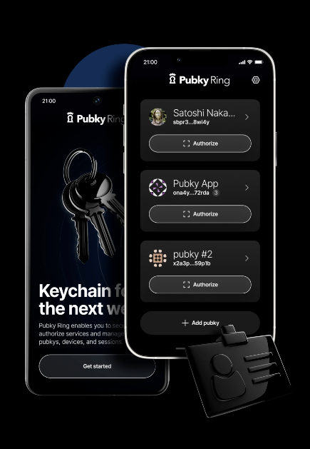

# Pubky Ring

**Your keychain for the next web.**

Pubky Ring is a mobile key manager for the [Pubky ecosystem](https://pubky.org/). Create and organize identities, approve app access, and back up your keys while keeping control of them.

## Download

[iOS App Store](https://apps.apple.com/app/pubky-ring/id6739356756) · [Google Play](https://play.google.com/store/apps/details?id=to.pubky.ring) · [Android APK releases](https://github.com/pubky/pubky-ring/releases)

For APK verification, see the [release verification guide](docs/security.md#verifying-android-releases).

## What you can do

- Create, import, and label multiple pubky identities.
- Review app access requests and revoke authorized apps.
- Back up and restore keys using recovery phrases or password-protected files.
- Transfer keys between devices using migration QR codes.
- Choose and manage homeservers for your identities.

  

[See Pubky Ring in action](https://pubkyring.app/).

## Get started

1. Install Pubky Ring, then create a pubky or import an existing one.
2. Open a compatible app such as [pubky.app](https://pubky.app/). Scan its sign-in or signup QR code with Ring and review the request before approving it.
3. Back up your key from its identity screen. Keep your recovery phrase and backup password private and stored somewhere safe.

A key backup protects your identity; it does not back up the data stored by your apps. See the [Pubky getting-started guide](https://pubky.org/getting-started/) for more about identities and data backups.

## Help and feedback

- [Report a bug or request a feature](https://github.com/pubky/pubky-ring/issues).
- [Read the Pubky Ring user guide](https://pubky.org/pubky-ring/).
- [Privacy policy](https://synonym.to/pubky-ring-privacy-policy).

## Contributing

For building or contributing to Ring, see the [development guide](docs/development.md). App integrations are covered in [input formats](docs/input-formats.md); authentication behavior, release verification, and device test coverage are documented in the [security guide](docs/security.md).
